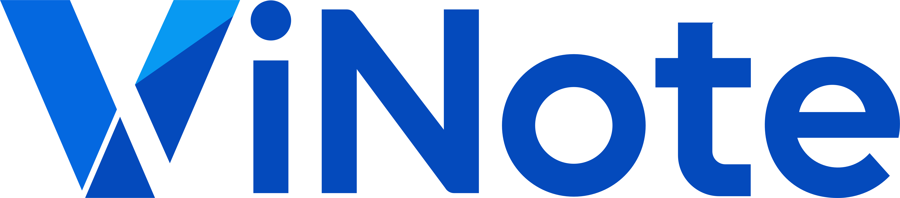

<div align="center">



# ViNote 2.0

**Video to Everything**

本地优先的视频知识工作台。让每个视频成为可检索、可引用、可复习的知识资产。

[](LICENSE)

</div>

## 2.0 产品规格

视频、音频、字幕或链接先进入知识库，成为一项资产。转录、摘要、翻译、问答、导图和卡片都关联同一资产。时间轴原文为问答引用、高亮、复习和导出提供可回查的证据。

| 页面 | 用途 |
| --- | --- |
| 工作台 | 导入媒体，继续最近的任务，查看失败任务和待复习内容 |
| 知识库 | 浏览、搜索和按主题整理资产 |
| 资产详情 | 播放视频、阅读时间轴原文、核对引用、管理高亮和生成产物 |
| 设置 | 管理模型、转录、存储和受控导入目录 |

当前分支是 **2.0 开发版，尚未发布**。应用已具备新导航和 SQLite 资产、任务、产物、转录等数据表；导入、播放、检索和生成等工作流尚未接入新页面。默认后端提供健康检查和 2.0 资产 API，可登记和查询资产、移入或恢复回收站，并查询任务状态和事件记录。登记资产仅保存元数据，不会读取媒体或执行转录。

2.0 不兼容 1.x 的工具页、API 或文件布局。启动仅初始化 2.0 数据表，不导入旧任务 JSON，也不修补旧笔记文件关联。

研发范围见 [2.0 规格](docs/v2.0-spec.md) 和 [实施计划](docs/v2.0-plan.md)。

## 本地开发

需要 Python 3.10+、uv、FFmpeg，以及 Node.js 20.19+ 或 22.12+。在仓库根目录运行：

```bash
uv sync --frozen
npm --prefix web ci
npm --prefix web run build
uv run --no-sync uvicorn backend.main:app --host 127.0.0.1 --port 8999
```

打开 <http://localhost:8999>，检查工作台、知识库和设置是否可进入。服务健康检查：

```bash
curl -f http://localhost:8999/health
```

也可以用 Docker Compose 启动：

```bash
cp .env.example .env
docker compose up -d --build
```

默认从本机访问。基础页面和健康检查不需要模型密钥；可参照 [配置示例](.env.example) 预先设置模型和 ASR，勿提交真实密钥。基础安装使用 Faster-Whisper；FunASR 和 Qwen3 仍是可选依赖。

## 许可证

[MIT](LICENSE)
